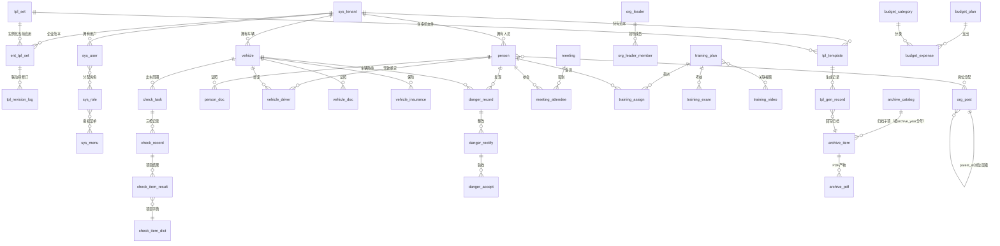
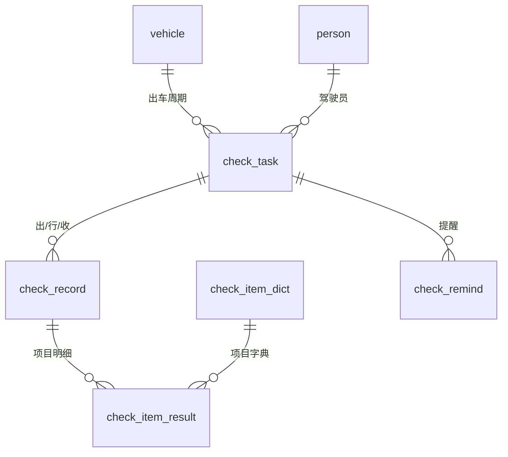
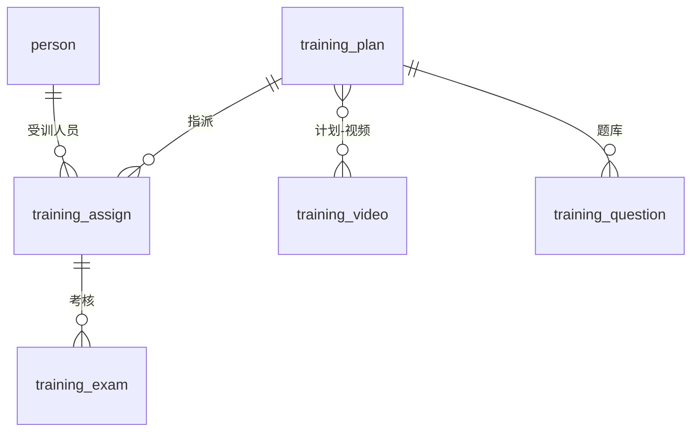
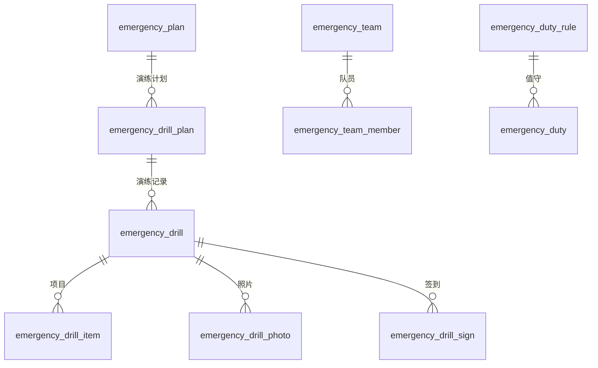
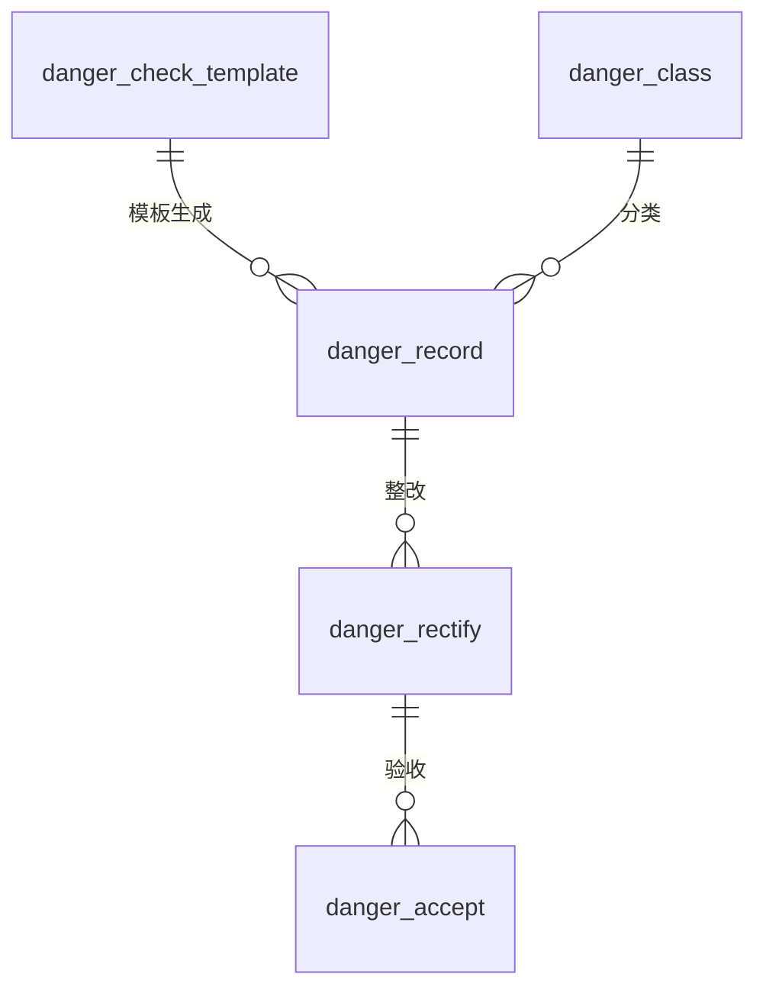

# 数据库设计文档

> 版本：v1.0
> 日期：2026-10-31
> 状态：已确认（与《00-系统架构设计文档》《00-产品定位与架构总纲》一致）
> 交付物：`database/schema.sql`（MySQL 8 完整 DDL，已实测可执行）+ 本文档

---

## 一、设计目标与范围

本数据库为「道路运输安全生产管理平台」的统一数据底座，覆盖 **PC 端 + 小程序端 + 服务商运营侧** 全部业务数据。设计严格对齐《00-系统架构设计文档》的数据库规范，并从 21 份详细设计文档（01~21）中提取全部建表语句，经**归一化 + 补全 + MySQL 8 实测**后产出。

| 指标 | 数值 |
|------|------|
| 数据表总数 | **106 张** |
| 字段总数 | **1286 个** |
| 业务域 | **18 个** |
| 租户隔离表 | 88 张（含子表） |
| 全局/字典/关联表 | 13 张（无租户隔离） |
| 物理外键 | 不建（逻辑外键 + 索引） |

---

## 二、数据库命名规范（对齐《00》第六章）

| 规则 | 约定 | 示例 |
|------|------|------|
| 表前缀按模块 | `sys_` 系统、`person_` 人员、`vehicle_` 车辆、`check_` 三检、`org_` 组织、`tpl_` 范本、`archive_` 归档等 | `person_doc`、`check_record` |
| 租户字段 | 每张业务表含 `tenant_id` | `tenant_id BIGINT` |
| 主键 | 雪花 ID（BIGINT，应用层生成，**非自增**） | `id BIGINT NOT NULL` |
| 审计字段 | `created_at` / `updated_at` / `created_by` | 统一标准 |
| 逻辑删除 | `deleted` 标志位（MyBatis-Plus 逻辑删除） | `deleted TINYINT NOT NULL DEFAULT 0` |
| 字符集 | `utf8mb4` + `utf8mb4_general_ci` | 全表统一 |
| 引擎 | `InnoDB` | 全表统一 |

---

## 三、公共字段规范（统一标准）

所有表强制统一以下公共字段（本文档已对 21 份设计文档中**格式不统一**的公共字段做了归一化）：

| 字段 | 标准定义 | 说明 |
|------|---------|------|
| `id` | `BIGINT NOT NULL` + 表级 `PRIMARY KEY` | 雪花 ID，应用层生成 |
| `tenant_id` | `BIGINT NOT NULL DEFAULT 0` | 租户 ID（业务表必有；`0`=平台） |
| `created_at` | `DATETIME NOT NULL DEFAULT CURRENT_TIMESTAMP` | 创建时间 |
| `updated_at` | `DATETIME NOT NULL DEFAULT CURRENT_TIMESTAMP ON UPDATE CURRENT_TIMESTAMP` | 更新时间（自动） |
| `created_by` | `BIGINT NOT NULL DEFAULT 0` | 创建人（业务表） |
| `deleted` | `TINYINT NOT NULL DEFAULT 0` | 逻辑删除 `0`否 `1`是 |

> **三类表的公共字段差异**：
> - **租户业务表**（88 张）：含全部 6 个公共字段。
> - **全局字典表**（11 张，平台预置）：无 `tenant_id`/`created_by`，含 `id`+`created_at`+`updated_at`+`deleted`。
> - **纯关联表**（`sys_user_role`/`sys_role_menu`）：用**复合主键**（无 `id`），含 `created_at`+`updated_at`+`deleted`。

---

## 四、表分类与业务域总览（18 域 · 106 表 · 1286 字段）

### 系统与认证（9 张表）

| 表名 | 中文名 | 字段数 | 租户隔离 |
|------|--------|--------|----------|
| `sys_tenant` | 企业（租户）主表 | 8 | 否（全局/关联） |
| `sys_user` | 用户账号 | 13 | 是 |
| `sys_role` | 角色 | 10 | 是 |
| `sys_menu` | 菜单/权限（菜单树+按钮权限） | 11 | 否（全局/关联） |
| `sys_user_role` | 用户-角色关联 | 5 | 否（全局/关联） |
| `sys_role_menu` | 角色-菜单关联 | 5 | 否（全局/关联） |
| `sys_dept` | 部门（系统内置） | 9 | 是 |
| `sys_group` | 企业分组/车组 | 8 | 是 |
| `sys_oper_log` | 全量操作日志（履职留痕） | 13 | 是 |

#### 账号与交付规则（本轮迭代补充）

- **租户状态 `sys_tenant.status`**：`正常` / `禁用`。禁用企业 → **同步禁用其全部 `sys_user`**（账号登录置灰），启用后恢复；企业数据档案继续留存 ≥3 年。
- **新增企业自动创建主账号**（交付标准动作）：服务商在「企业管理」新增企业时，系统自动创建企业主账号——`sys_user.username = 企业名称全称`，`sys_user.pwd = 888888`（初始）；同时生成「安全员」「驾驶员」默认子账号（初始密码同）。账号启用 / 停用、改密经 `sys_user` 接口实时同步各前端视角（见 01 文档 4.6）。
- **人员小程序账号自动开通**（录入即开通，见 01 文档 4.7 / 07 文档 7）：PC 端「人员管理」录入人员（姓名 / **手机号** / 岗位）时，**所有岗位自动开通小程序端账号**——`sys_user.username = 人员手机号`，`sys_user.pwd = 123456`（初始，首次登录强制改密），并通过 `person.telephone` 与人员主表绑定同一租户与角色；人员离职 / 停用 → `sys_user` 同步禁用，启用后恢复。小程序端按岗位渲染不同功能（驾驶员 / 押运员 / 安全员 / 管理员）。
- 代登（impersonation）仅切换操作视角，不转移数据所有权（见 01 文档 4.5）。

### 审批与预警（5 张表）

| 表名 | 中文名 | 字段数 | 租户隔离 |
|------|--------|--------|----------|
| `flow_process` | 审批流程实例 | 13 | 是 |
| `flow_node` | 审批节点 | 13 | 是 |
| `flow_config` | 审批配置（业务类型审批模板） | 11 | 是 |
| `warn_rule` | 预警规则 | 10 | 是 |
| `warn_record` | 预警记录 | 13 | 是 |

### 企业信息与接入（8 张表）

| 表名 | 中文名 | 字段数 | 租户隔离 |
|------|--------|--------|----------|
| `tenant_info` | 企业主体信息（租户扩展） | 29 | 是 |
| `tenant_cert` | 企业证照（子表） | 11 | 是 |
| `tenant_parking` | 停车场档案（独立页，一企业一条） | 15 | 是 |
| `tenant_veh_config` | 企业车辆配置 | 9 | 是 |
| `onboarding` | 接入初始化状态 | 9 | 是 |
| `onboarding_status` | 安全管理现状（选择题答案） | 9 | 是 |
| `collect_task` | 智能资料收集任务 | 10 | 是 |
| `collect_result` | 智能资料收集解析结果 | 10 | 是 |

### 组织架构（9 张表）

| 表名 | 中文名 | 字段数 | 租户隔离 |
|------|--------|--------|----------|
| `org_dict` | 职能字典（标准部门/岗位，平台预置） | 8 | 否（全局/关联） |
| `org_post` | 岗位（无部门层，parent_id 组织层级） | 20 | 是 |
| `org_post_content` | org_post_content | 9 | 是 |
| `org_member` | 人员-岗位分配（人员从系统已录入人员选取） | 11 | 是 |
| `org_leader` | 领导机构 | 9 | 是 |
| `org_leader_member` | 领导机构成员 | 9 | 是 |
| `org_compliance_template` | 法规最低架构模板（内置） | 12 | 否（全局/关联） |
| `org_outsource` | 委托第三方监控标记 | 9 | 是 |
| `org_compliance_check` | 合规校验结果 | 10 | 是 |

### 人员档案（4 张表）

| 表名 | 中文名 | 字段数 | 租户隔离 |
|------|--------|--------|----------|
| `person` | 人员主表（一人一档） | 15 | 是 |
| `person_doc` | 人员证照/文件（子表） | 13 | 是 |
| `person_archive_dict` | 一人一档归档项字典 | 10 | 否（全局/关联） |
| `person_archive_item` | 一人一档归档子项 | 13 | 是 |

### 车辆档案（9 张表）

| 表名 | 中文名 | 字段数 | 租户隔离 |
|------|--------|--------|----------|
| `vehicle` | 车辆主表（一车一档） | 31 | 是 |
| `vehicle_doc` | 车辆证照/文件（子表） | 13 | 是 |
| `vehicle_doc_dict` | 一车一档证照字典 | 10 | 否（全局/关联） |
| `vehicle_insurance` | 车辆保险 | 12 | 是 |
| `vehicle_grade` | 车辆技术等级评定 | 11 | 是 |
| `vehicle_device` | 车辆设备（卫星定位等） | 9 | 是 |
| `vehicle_driver` | 车辆-驾驶员绑定 | 11 | 是 |
| `vehicle_link` | 车辆挂靠关系 | 10 | 是 |
| `veh_type` | 车型字典（平台预置） | 9 | 否（全局/关联） |

### 范本引擎（10 张表）

| 表名 | 中文名 | 字段数 | 租户隔离 |
|------|--------|--------|----------|
| `tpl_set` | 范本套/模板集（服务商全局，所有企业可调用） | 14 | 是（服务商侧 tenant_id=0） |
| `tpl_template` | 范本模板（主表，归属某个范本套） | 17 | 是 |
| `tpl_field_dict` | 范本字段字典 | 9 | 否（全局/关联） |
| `tpl_group` | 范本分组 | 12 | 是 |
| `tpl_spec_group` | 范本规格组字典 | 10 | 否（全局/关联） |
| `tpl_seal` | 印章库 | 9 | 是 |
| `tpl_signature` | 签字库（历史签字数据） | 11 | 是 |
| `tpl_gen_record` | 范本生成记录 | 13 | 是 |
| `ent_tpl_set` | 企业范本（当前应用范本 + 另存为的我的范本变体） | 15 | 是 |
| `tpl_revision_log` | 制度联动待修订记录（提示保存/另存为） | 10 | 是 |

### 台账归档（3 张表）

| 表名 | 中文名 | 字段数 | 租户隔离 |
|------|--------|--------|----------|
| `archive_catalog` | 档案盒目录（11盒·跨年稳定） | 14 | 是 |
| `archive_item` | 归档子项（按年度建实例） | 19 | 是 |
| `archive_pdf` | 归档 PDF 产物（带年度落款） | 16 | 是 |

> **上传留存（`src='upload'`）**：证照 / 保单 / 检验报告等实物类归档项以**上传**为生产方式——`archive_item.gen_mode = 3`（上传留存，扩展自原 1 真实流程 / 2 先台账后执行），上传文件落 `archive_pdf`（`file_path` 存 MinIO/OSS，`gen_time` 记上传时间），状态置"已生成"。生成类项亦可"上传留存"纸质签字页 / 现场照片作为佐证，与生成 PDF 并存。详见 08 文档 6.4.4。

> **年度维度（本轮迭代新增）**：电子档案柜整体按**自然年度归档**，可在不同年度间切换查看各自独立的归档状态（各年度状态相互隔离）。数据层落地方式：
> - `archive_catalog` 为**跨年稳定的目录模板**（11 盒结构不随年度变化，**不挂年度字段**）；
> - `archive_item` 按 **`(tenant_id, catalog_id, archive_year)` 每年一条归档实例**——一年一签 / 每月生成 / 每日等周期性资料每年生成新实例，ONCE 类仅一条（`archive_year` = 产生年度）；
> - `archive_pdf` 携带 `archive_year` 用于 PDF 落款与按年存储。
> 查询某年度台账统一以 `archive_year = ?` 过滤，与前端「归档年度」切换条一一对应。

**`archive_item` / `archive_pdf` 新增字段**

| 表 | 字段 | 类型 | 说明 |
|----|------|------|------|
| `archive_item` | `archive_year` | `SMALLINT` | 归档年度（自然年度，如 2026）；年度归档核心维度。周期性资料每年一条实例，ONCE 类仅一条 |
| `archive_pdf` | `archive_year` | `SMALLINT` | 归档年度（落款用，对齐对应归档项的 `archive_year`；按年归档时 PDF 也按年隔离） |

### 一日三检（6 张表）

| 表名 | 中文名 | 字段数 | 租户隔离 |
|------|--------|--------|----------|
| `check_config` | 三检配置 | 9 | 是 |
| `check_item_dict` | 三检项目字典（平台预置） | 11 | 否（全局/关联） |
| `check_task` | 三检任务（出车周期） | 22 | 是 |
| `check_record` | 三检记录（出/行/收） | 14 | 是 |
| `check_item_result` | 三检项目结果（明细） | 10 | 是 |
| `check_remind` | 三检提醒 | 10 | 是 |

> **行车日志字段对齐（本轮迭代新增）**：为对齐台账样例「企业车辆行车日志」，`check_task` 新增 `mileage_start`（出车公里数）/`mileage_end`（收车公里数）/`cargo_name`（货物名称）/`cargo_qty`（货物数量）/`origin`（始发地）/`stopover`（中途停靠地）/`destination`（目的地）7 个字段，配合三时段检查明细生成完整行车日志台账（见 11 文档 3.5）。

### 隐患排查（5 张表）

| 表名 | 中文名 | 字段数 | 租户隔离 |
|------|--------|--------|----------|
| `danger_record` | 隐患排查记录 | 17 | 是 |
| `danger_check_template` | 隐患排查模板 | 10 | 是 |
| `danger_class` | 隐患分类字典 | 9 | 否（全局/关联） |
| `danger_rectify` | 隐患整改 | 14 | 是 |
| `danger_accept` | 隐患验收 | 11 | 是 |

### 安全会议（3 张表）

| 表名 | 中文名 | 字段数 | 租户隔离 |
|------|--------|--------|----------|
| `meeting` | 安全会议 | 21 | 是 |
| `meeting_attendee` | 会议签到/参会人 | 14 | 是 |
| `meeting_record` | 会议纪要 | 10 | 是 |

### 培训教育（6 张表）

| 表名 | 中文名 | 字段数 | 租户隔离 |
|------|--------|--------|----------|
| `training_plan` | 培训计划 | 19 | 是 |
| `training_assign` | 培训指派 | 16 | 是 |
| `training_video` | 培训视频 | 13 | 是 |
| `training_plan_video` | 培训计划-视频关联 | 10 | 是 |
| `training_question` | 题库 | 12 | 是 |
| `training_exam` | 考核记录 | 13 | 是 |

### 应急管理（12 张表）

| 表名 | 中文名 | 字段数 | 租户隔离 |
|------|--------|--------|----------|
| `emergency_plan` | 应急预案 | 16 | 是 |
| `emergency_plan_tpl` | 应急范本模板（预置） | 12 | 否（全局/关联） |
| `emergency_equipment` | 应急物资 | 13 | 是 |
| `emergency_team` | 应急队伍 | 9 | 是 |
| `emergency_team_member` | 应急队伍成员 | 10 | 是 |
| `emergency_duty` | 应急值守 | 10 | 是 |
| `emergency_duty_rule` | 应急值守规则 | 10 | 是 |
| `emergency_drill_plan` | 应急演练计划 | 10 | 是 |
| `emergency_drill` | 应急演练记录 | 12 | 是 |
| `emergency_drill_item` | 演练项目明细 | 14 | 是 |
| `emergency_drill_photo` | 演练照片 | 10 | 是 |
| `emergency_drill_sign` | 演练签到 | 11 | 是 |

### 事故管理（4 张表）

| 表名 | 中文名 | 字段数 | 租户隔离 |
|------|--------|--------|----------|
| `accident_record` | 事故记录 | 21 | 是 |
| `accident_quick_report` | 事故快报 | 11 | 是 |
| `accident_service` | 事故增值服务 | 13 | 是 |
| `accident_year_summary` | 事故年度汇总 | 13 | 是 |

### 安全投入（3 张表）

| 表名 | 中文名 | 字段数 | 租户隔离 |
|------|--------|--------|----------|
| `budget_plan` | 安全费用计提计划 | 15 | 是 |
| `budget_expense` | 安全费用支出 | 12 | 是 |
| `budget_category` | 安全费用支出类别 | 9 | 是 |

### 风险辨识（4 张表）

| 表名 | 中文名 | 字段数 | 租户隔离 |
|------|--------|--------|----------|
| `risk_list` | 风险清单 | 16 | 是 |
| `risk_card` | 风险卡 | 11 | 是 |
| `risk_manual` | 风险手册 | 10 | 是 |
| `risk_point_dict` | 风险点字典 | 11 | 是 |

### 考核奖惩（3 张表）

| 表名 | 中文名 | 字段数 | 租户隔离 |
|------|--------|--------|----------|
| `credit_assess` | 诚信考核 | 9 | 是 |
| `credit_assess_item` | 诚信考核项目 | 17 | 是 |
| `credit_reward_notice` | 考核奖惩公示 | 19 | 是 |

> `credit_reward_notice`：安全生产考核**奖惩公示**台账表，字段与台账样例「安全生产考核奖惩公示」逐字段对应（考核类型/周期/结果/被考核对象/被考核人/考核标准/评定条件/奖惩详情/签字/备注/公示时间），归档到盒十一「从业人员奖惩公示」（见 19 文档 3.4）。

### 动态监控（3 张表）

| 表名 | 中文名 | 字段数 | 租户隔离 |
|------|--------|--------|----------|
| `monitor_ledger` | 动态监控台账留存（上传 + 统计） | 18 | 是 |
| `monitor_violation` | 动态监控违规记录（含教育闭环） | 17 | 是 |
| `violation_dict` | 违法字典 | 6 | 否（全局/关联） |

> `monitor_ledger`：外部动态监控平台 / 交警抄报结果的**台账上传留存**表（工作情况、设备故障、在线率 / 月报等），本系统只做归档不实时监测。`monitor_violation` 在原有违规登记基础上新增教育闭环字段：`education_plan_id`（关联 14 的靶向教育计划）、`education_status`（none/pushed/learning/passed/archived）、`education_completed_at`（考核通过时间），支撑"违规 → 靶向教育 → 落实"跟踪（见 20 文档）。

---

## 五、核心 ER 图

### 关键域 ER 图（复杂域展开）

**① 一日三检域**

**② 培训教育域**

**③ 应急管理域**

**④ 隐患排查域**

---

## 六、主要外键关系清单（逻辑外键）

> 本文档**不建物理外键**（见第八节决策 3），以下为逻辑外键，实际以索引约束 + 应用层维护。

| 源表.字段 | 目标表 | 关系 | 说明 |
|-----------|--------|:---:|------|
| 全部业务表 `.tenant_id` | `sys_tenant.id` | N:1 | 租户隔离 |
| `sys_user_role.user_id` / `.role_id` | `sys_user.id` / `sys_role.id` | N:1 | 用户-角色 |
| `sys_role_menu.role_id` / `.menu_id` | `sys_role.id` / `sys_menu.id` | N:1 | 角色-菜单 |
| `flow_node.process_id` | `flow_process.id` | N:1 | 审批节点 |
| `flow_node.approver_id` | `sys_user.id` | N:1 | 审批人 |
| `org_member.user_id` / `.post_id` | `sys_user` / `org_post` | N:1 | 人员-岗位（从系统已录入人员选取） |
| `org_leader_member.leader_org_id` / `.user_id` | `org_leader` / `sys_user` | N:1 | 领导成员 |
| `person.dept_id` | 文本化统计用（架构不再依赖部门） | - | 部门展示 |
| `person_doc.person_id` | `person.id` | N:1 | 人员证照 |
| `vehicle_doc.vehicle_id` | `vehicle.id` | N:1 | 车辆证照 |
| `vehicle_insurance.vehicle_id` | `vehicle.id` | N:1 | 车辆保险 |
| `vehicle_grade.vehicle_id` | `vehicle.id` | N:1 | 技术等级 |
| `vehicle_device.vehicle_id` | `vehicle.id` | N:1 | 车载设备 |
| `vehicle_driver.vehicle_id` / `.driver_id` / `.escort_id` | `vehicle` / `person` / `person` | N:1 | 车辆-驾驶员 |
| `check_task.vehicle_id` / `.driver_id` / `.escort_id` | `vehicle` / `person` / `person` | N:1 | 三检任务 |
| `check_record.task_id` | `check_task.id` | N:1 | 三检记录 |
| `check_item_result.record_id` / `.item_id` | `check_record` / `check_item_dict` | N:1 | 项目结果 |
| `danger_rectify.danger_id` | `danger_record.id` | N:1 | 隐患整改 |
| `danger_accept.danger_id` | `danger_record.id` | N:1 | 隐患验收 |
| `meeting_attendee.meeting_id` / `.user_id` | `meeting` / `sys_user` | N:1 | 会议签到 |
| `meeting_record.meeting_id` | `meeting.id` | N:1 | 会议纪要 |
| `training_assign.plan_id` / `.user_id` | `training_plan` / `sys_user` | N:1 | 培训指派 |
| `training_exam.assign_id` / `.user_id` | `training_assign` / `sys_user` | N:1 | 考核记录 |
| `training_plan_video.plan_id` / `.video_id` | `training_plan` / `training_video` | N:1 | 计划-视频 |
| `emergency_team_member.team_id` / `.user_id` | `emergency_team` / `sys_user` | N:1 | 应急队员 |
| `emergency_drill_item.plan_id` | `emergency_drill_plan.id` | N:1 | 演练项目 |
| `emergency_drill_photo.drill_id` | `emergency_drill.id` | N:1 | 演练照片 |
| `emergency_drill_sign.drill_id` / `.user_id` | `emergency_drill` / `sys_user` | N:1 | 演练签到 |
| `budget_expense.plan_id` / `.category_id` | `budget_plan` / `budget_category` | N:1 | 费用支出 |
| `archive_item.catalog_id` | `archive_catalog.id` | N:1 | 归档子项 |
| `archive_pdf.item_id` | `archive_item.id` | N:1 | PDF 产物 |
| `tpl_template.group_id` | `tpl_set.id` | N:1 | 范本归属范本套 |
| `tpl_gen_record.template_id` | `tpl_template.id` | N:1 | 范本生成 |
| `tpl_gen_record.archive_item_id` | `archive_item.id` | N:1 | 生成回写 |
| `credit_assess_item.assess_id` / `.user_id` | `credit_assess` / `sys_user` | N:1 | 考核项目 |
| `accident_service.accident_id` | `accident_record.id` | N:1 | 事故服务 |
| `accident_quick_report.accident_id` | `accident_record.id` | N:1 | 事故快报 |

---

## 七、索引策略

| 索引类型 | 策略 | 说明 |
|---------|------|------|
| 主键索引 | 所有表 `PRIMARY KEY (id)`；纯关联表用复合主键 | 雪花 ID 顺序写入 |
| 租户索引 | 所有租户业务表 `KEY idx_<表名>_tenant_id (tenant_id)` | 多租户查询第一过滤条件 |
| 唯一索引 | 保留设计文档中的唯一约束 | 如 `check_task` 的 `(tenant_id, vehicle_id, is_trailer, start_date)` |
| 外键索引 | 高频关联字段按需补充 | 开发阶段根据慢查询补充，不在首版穷举 |
| 年度索引 | `archive_item` 加 `KEY idx_archive_item_year (tenant_id, catalog_id, archive_year)` | 年度归档切换的核心查询路径（按年过滤归档状态）；`archive_pdf` 另加 `(tenant_id, archive_year)` 便于按年列举成品 |

---

## 八、关键设计决策

### 决策 1：主键用雪花 ID，非自增

对齐《00》扩展性铁律第 2 条。`BIGINT` 雪花 ID 由应用层（MyBatis-Plus `ASSIGN_ID`）生成，为未来分库分表预留，避免自增主键分表冲突。

### 决策 2：多租户字段级隔离

所有业务表（含子表/明细表）统一含 `tenant_id`，MyBatis-Plus 租户插件自动注入。子表冗余 `tenant_id` 虽略增冗余，但换取「子表可独立做租户过滤」的一致性，避免跨表 join 才能定位租户。

### 决策 3：不建物理外键，用逻辑外键 + 索引

MySQL 生产实践常用做法：**物理外键**会带来级联删除、锁竞争、DDL 迁移困难等问题。本库采用「逻辑外键（应用层维护）+ 索引（保证查询性能）」策略，实体关系以本文档第五节 ER 图 + 第六节关系清单为准。

### 决策 4：逻辑删除（软删除）

所有表含 `deleted` 标志位，MyBatis-Plus 逻辑删除统一处理。**操作日志 `sys_oper_log` 不可删改**（对齐《00》"数据可改、日志不改"原则），但业务数据本身允许超管修改，两者不冲突。

### 决策 5：JSON 字段承载灵活结构

照片列表、附件、变量快照、范本内容等用 `VARCHAR(2000)`/`TEXT`/`JSON`/`LONGTEXT` 承载，避免为动态内容建过多关联表。核心可查询字段仍用结构化列。

### 决策 6：子表冗余 tenant_id

对齐《00》"每张业务表含 tenant_id"铁律，`check_item_result`、`collect_result`、`flow_node`、`org_leader_member` 等子表统一补 `tenant_id`，使租户插件全表生效。

### 决策 7：归档项按自然年度建实例（年度维度）

电子档案柜以**自然年度**为归档单位（责任书 / 承诺书一年一度重签，月度 / 每日台账逐年生成）。据此 `archive_item` **不以"资料"为唯一行**，而以 **`(tenant_id, catalog_id, archive_year)`** 每年一条归档实例——历史年实例沉淀为"已打印 / 已归档"状态，当前年实例按流程逐年重做 / 重签，二者互不污染（各年度状态隔离）。`archive_catalog` 保持跨年稳定的目录模板（不挂年度字段），`archive_pdf` 通过 `archive_year` 字段与实例对齐并实现按年落款。该建模与前端「归档年度」切换条、重签预警横幅（仅当前年提示待重签）完全自洽。

---

## 九、验证记录

| 验证项 | 结果 |
|--------|------|
| 字段完整性（对比 21 份文档原始字段） | ✅ 101 张表，0 字段丢失 |
| 括号/主键/空类型自检 | ✅ 全部通过 |
| **MySQL 8 实际建表**（Docker `mysql:8.0`，`utf8mb4`） | ✅ **101 张表全部建成，0 错误** |
| 公共字段归一化（updated_at/created_by/deleted 补全） | ✅ 96 张表已补全 |
| 重复表去重（flow_process/flow_node 取完整版） | ✅ 已处理 |
| **年度维度下沉**（archive_item / archive_pdf 新增 `archive_year`，按年建实例 + 年度索引） | ✅ 已落到 `schema.sql` 与本文档 |

---

## 十、与已有设计文档的关系

| 文档 | 关系 |
|------|------|
| 《00-系统架构设计文档》 | 本文档是其中"数据库命名规范""模块划分"的落地 |
| 《01~21 详细设计》 | 本文档的字段规格来源（21 份文档内嵌的建表语句） |
| 《一致性审查报告》 | 本文档在归档映射/模板命名上与其结论一致 |

> **后续衔接**：本文档交付后，可进入 **API 设计**（基于本文档的表/字段定义 REST 接口）与 **项目骨架搭建**（Spring Boot + MyBatis-Plus 生成实体/ Mapper）。
